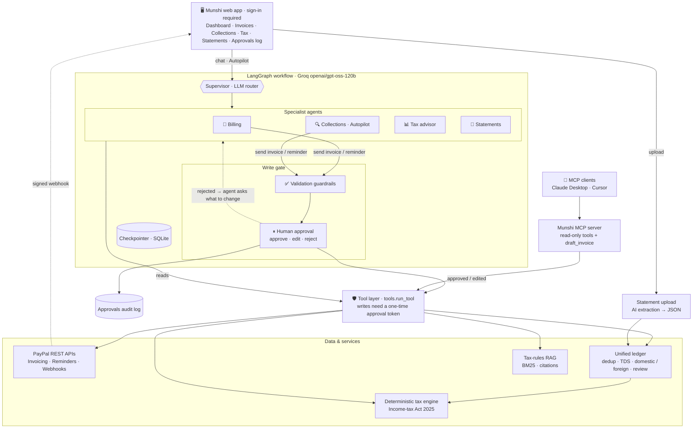

# Munshi मुंशी: an AI accountant for India's cross-border freelancers

> **Bill clients through PayPal in plain words. See every rupee you earned across PayPal, Upwork and your bank, with nothing counted twice. Know your tax under India's new Income-tax Act 2025. Nothing reaches a client without your approval.**

Built for the **PayPal "Build What's Next with PayPal and AI" hackathon** · Python · LangGraph · Groq · PayPal REST APIs · MCP

🔗 **Live demo:** `<RENDER_URL>` · **Demo login:** see the Devpost testing instructions · 🎥 **Video:** `<YOUTUBE_URL>`

---

## The problem

India has one of the world's largest freelance workforces, and much of it is paid by **foreign clients through PayPal**. Every one of those freelancers faces the same mess:

- **Income is scattered** across PayPal, Upwork, Indian clients paying by UPI, and the bank account it all lands in. The same money shows up two or three times (an Upwork payment, then its withdrawal to the bank).
- **Tax is confusing and just changed.** From 1 April 2026 the **Income-tax Act 2025** replaced the 1961 Act. 44ADA became **Section 58**, 194J became **Section 393**, and "assessment year" became "tax year". Many freelancers over-pay because they don't know that, under the presumptive scheme, **someone on track for ₹20 lakh can owe ₹0**.
- **Compliance details get missed:** RBI purpose codes, GST export under LUT, the ₹20 lakh GST threshold, TDS from Indian clients, and the advance-tax deadline.
- **Chasing late payers** is awkward and easy to forget.

## What Munshi does

| | |
|---|---|
| 💸 **Bill in plain English** | *"Bill Kestrel Health $1,500 for app maintenance"* creates a real **PayPal invoice** with the RBI purpose code and the GST "export under LUT" line, and shows it to you for approval before sending. |
| 🔍 **Autopilot collections** | An agent checks PayPal for new payments, finds invoices that are due or overdue, and drafts reminders whose tone fits how late they are. **You approve each email.** |
| 📄 **One unified ledger** | Drop in Upwork and bank statements. AI extracts client payments, fees and TDS; foreign and Indian (UPI/NEFT) clients are tagged; **payouts already counted are caught as duplicates**; uncertain credits wait for your **Count / Not income** decision. |
| 📊 **Tax under the 2025 Act** | A **deterministic calculator** compares the presumptive scheme (Sec 58: 50% for professions, 6% for business) with the regular method, applies the ₹12 L rebate, TDS credits and the advance-tax rules, and lists its assumptions. *The AI explains; it never computes the numbers.* |
| 📚 **Cited tax rules (RAG)** | The Tax advisor answers *"Do I need GST registration?"* from a curated knowledge base, with **citations**, and says **"I don't know, ask a CA"** when a question isn't covered. |
| 🔌 **MCP server** | Claude Desktop, Cursor or any MCP client can read your books and tax position. **Sending money is deliberately not exposed.** |
| 🛡️ **Safe by design** | Human approval enforced in the backend, validation guardrails, an audit log, sign-in, a signature-verified webhook, and retries for PayPal outages. |

**Screenshots:** `docs/dashboard.png` · `docs/approval.png` · `docs/statements.png` · `docs/tax.png` *(add before submitting)*

---

## Architecture



*(Also as an image: [`docs/architecture.png`](docs/architecture.png))*

**Key design decisions**

1. **The AI understands and acts; the money maths is code.** Tax figures come only from `tax.py`, which is tested exactly. RAG supplies rules and citations in parallel and never feeds numbers into the calculator.
2. **Reads never pause; writes always do.** Anything that emails a client or bills money goes **agent → validation → human approval → PayPal**. An edit counts as an approval with changes and is validated again. A rejection goes back to the agent, which asks what to change.
3. **Approval is enforced in the backend, not just in prompts or graph routing.** `tools.run_tool` only executes a write tool when it gets an approval record whose arguments hash matches **exactly**, and each record can be used **once**. A tampered amount, a replayed approval or a rejection used as an approval are all blocked, whether the call comes from an agent, an endpoint or MCP.
4. **MCP faces outward.** Munshi is an MCP *server*, so other AI assistants can use its books, tax engine and RAG. Inside, Munshi calls PayPal's REST APIs directly, which keeps every write behind its own approval gate.
5. **Each specialist agent has a narrow toolset.** The Tax advisor can't send invoices; the supervisor only routes.

---

## How each AI tool is used

| Tool | Where | What it does |
|---|---|---|
| **Groq · `openai/gpt-oss-120b`** | `llm.py` | Fast LLM inference for the supervisor (JSON routing), the 4 agents (tool calling), statement extraction (JSON mode) and the eval judge |
| **LangGraph** | `graph.py` | State graph: supervisor → specialist agents ⇄ tools; `interrupt()` pauses for human approval and `Command(resume=…)` continues; SQLite checkpointer keeps paused workflows across restarts |
| **Multi-agent design** | `graph.py`, `tools.py` | Billing, Collections (Autopilot), Tax advisor and Statement agents, each with its own prompt and tool subset |
| **RAG** | `rag.py`, `knowledge/` | 7 documents and 30+ sections on Indian freelancer tax and compliance, written as our own summaries with sources; BM25 retrieval (no external service); citations; multi-hop (search again before mentioning an unretrieved rule); abstains when the topic isn't covered |
| **MCP** (Python SDK v2) | `mcp_server.py` | 5 read-only tools + `draft_invoice`, 7 knowledge resources, a `tax_checkup` prompt; tested in Claude Desktop |
| **LLM-as-judge evals** | `evals/run_evals.py` | Scores whether RAG answers are grounded and cited, and whether the model abstains when it should |

## How PayPal is used

| PayPal capability | Used for |
|---|---|
| **OAuth 2.0 client credentials** | Server-to-server auth, with the token cached until expiry |
| **Invoicing API v2**: create + send | Turning a plain-English request into a real invoice (purpose code + LUT note) emailed to the client with a pay link |
| **Invoicing API v2**: list | Live invoice status (SENT / PAID / overdue): the source of truth for income, pending money and Autopilot |
| **Invoicing API v2**: remind | Sending the reminder drafted by the Collections agent (after approval) |
| **Webhooks** + **verify-webhook-signature** | `/api/paypal/webhook` accepts only PayPal-signed events and is idempotent on event ID |
| **Sandbox** | All development and the demo. No real money moves. |

PayPal doesn't support domestic payments in India, so Munshi says so and drafts a UPI payment request for Indian clients instead of attempting a PayPal invoice.

---

## Safeguards

- **Human-in-the-loop** for every client-facing or money-moving action, with an editable approval card in the chat
- **Backend approval tokens** (exact argument hash, single use) plus an **audit log** of every decision
- **Validation guardrails** before approval: email, amount cap, currency, due date, clean client name, compulsory purpose code and LUT line; no reminders for PAID or invented invoices
- **No guessing:** missing details are asked for, uncertain bank credits wait for the user, and the advisor abstains when the knowledge base doesn't cover a question
- **Sign-in:** scrypt-hashed password, HMAC-signed HttpOnly session cookie (12 h), lockout after 5 failures, CSRF origin check, `no-store` on private pages
- **Webhook:** signature verified via PayPal; duplicate deliveries ignored
- **Resilience:** PayPal reads retried with backoff and served from the last good sync if the sandbox is down; writes never retried blindly (no duplicate invoices); Groq rate limits respected (`Retry-After`)

---

## Evaluation

`python evals/run_evals.py` runs **115 checks in 6 suites**. PayPal is **mocked** and the databases are temporary, so evals never send anything or touch real data.

| Suite | What it proves | Result |
|---|---|---|
| A. Tax engine | Slabs, ₹12 L rebate, marginal relief, presumptive vs regular, 6% business scheme, ₹75 L limit, TDS credit/refund, advance-tax rules | **16/16** |
| B. Guardrails & enforcement | Validation; writes blocked without approval; tamper/replay/reject blocked; webhook idempotency; dedup (incl. an Indian UPI never mistaken for a payout); review flow; TDS | **25/25** |
| C. RAG retrieval | Right rule section in the top 3 (top-1 also reported) | **20/20** |
| D. Supervisor routing | 17 messages → correct specialist agent | **17/17** |
| E. Agents + human-in-the-loop | Right tool and arguments; pauses before sending; sends exactly once after approval, never after rejection; asks for missing email; won't chase PAID/invented invoices; tax figure matches calculator; Autopilot; Indian client handled | **18/18** |
| F. RAG faithfulness (LLM-as-judge) | Answers grounded in retrieved rules, cited, and abstains for out-of-scope topics (e.g. crypto) | **19/19** |
| **Total** | | **115/115 (100%)** |

**How the evals improved Munshi.** The first run scored **92/93**. The judge caught an answer that stated a correct rule ("the 50% rate is only for specified professions") that was **not written in the knowledge base**. We fixed the source document rather than the test. A later run caught an ungrounded mention of LUT, which led to retrieving 4 passages and a **multi-hop rule** (search again before mentioning anything not retrieved). Rate-limit failures led to `Retry-After`-aware retries. Each fix was confirmed by re-running the suite.

---

## Run it yourself

**Requirements:** Python 3.11+, a [PayPal developer](https://developer.paypal.com) sandbox app (with **Invoicing** enabled under Features), and a free [Groq](https://console.groq.com) API key.

```bash
git clone https://github.com/<you>/munshi.git && cd munshi
python -m venv .venv && source .venv/bin/activate      # Windows: .venv\Scripts\activate
pip install -r requirements.txt
cp .env.example .env                                     # Windows: copy .env.example .env
```

Fill in `.env`:

| Variable | Where to get it |
|---|---|
| `PAYPAL_CLIENT_ID`, `PAYPAL_CLIENT_SECRET` | developer.paypal.com → Apps & Credentials → **Sandbox** → your app (enable **Invoicing**) |
| `SANDBOX_CLIENT_EMAIL` | Testing Tools → Sandbox Accounts → the **@personal.example.com** account (plays your foreign client) |
| `GROQ_API_KEY` | console.groq.com → API Keys |
| `USD_INR` | Today's rate, e.g. `94` |
| `FREELANCER_TYPE` | `profession` (IT, engineering, consulting… 50%) or `business` (6%) |

```bash
python test_paypal.py        # checks your PayPal keys: should print "Invoicing permission: YES"
python set_password.py       # creates your sign-in (stored as a scrypt hash in .env)
python seed_demo.py          # optional: creates due-soon / overdue invoices for Autopilot
uvicorn server:app --reload  # open http://localhost:8000
```

**Try it:** Statements → *Try sample: Upwork* and *Try sample: HDFC bank* → see duplicates caught, an Indian client with TDS and a credit waiting for review · Chat: *"Bill Lumen Studio at <sandbox personal email> $600 for a logo"* → edit and approve · **Run Autopilot** · Tax → *"Do I need GST registration?"* · Pay an invoice as the client at `https://www.sandbox.paypal.com/invoice/p/#<INVOICE_ID>` with the sandbox Personal account.

**Other entry points**

```bash
python chat.py               # the same agents in the terminal, with y/n/e approvals
python evals/run_evals.py    # full eval suite (add --offline for no API calls)
python mcp_selftest.py       # checks the MCP server like an MCP client would
```

**Claude Desktop (MCP):** Settings → Developer → Edit Config:
```json
{ "mcpServers": { "munshi": { "command": "python", "args": ["/full/path/to/munshi/mcp_server.py"] } } }
```

---

## Project structure

```
server.py          FastAPI app: pages, chat/approve/autopilot APIs, upload, webhook, auth middleware
graph.py           LangGraph: supervisor, 4 agents, tools node, validation + human-approval node
tools.py           Tool specs, per-agent tool subsets, validation guardrails, approval-token enforcement
llm.py             Groq client (tool calling, JSON mode, rate-limit-aware retries)
paypal_client.py   PayPal OAuth, Invoicing (create/send/list/remind), webhook verification, retries + cache
ledger.py          Unified ledger: statement AI extraction, dedup, domestic/foreign, TDS, review, GST status
tax.py             Deterministic tax engine (Income-tax Act 2025, new regime)
rag.py             BM25 retrieval over knowledge/*.md with citations
mcp_server.py      MCP server (read-only tools, knowledge resources, prompt)
auth.py            Sign-in: scrypt hashes, signed session cookies, lockout
db.py              SQLite: imported entries, approvals audit, webhook events, settings
knowledge/         Tax & compliance knowledge base (own summaries + sources)
evals/             Eval suite and scorecard
static/            index.html (app) and login.html
samples/           Sample Upwork and HDFC bank statements
```

## Limitations and future work

- **Estimates, not tax filing.** New regime, resident individual, no surcharge, one FX rate. Always confirm with a CA.
- **Single owner account.** Next: multi-user with **Log in with PayPal**, per-user data, and a consent-based profile/memory store (name, LUT number, default purpose code).
- **PayPal Agent Toolkit / MCP server** as an alternative PayPal connector; Payouts for paying collaborators.
- **Elastic** semantic search for RAG; AIS / Form 26AS import to reconcile TDS automatically; per-receipt FX rates; GST return helper; old-regime comparison.
- A full double-entry ledger (expenses, assets) on top of today's unified income ledger.

## License

[MIT](LICENSE). Knowledge-base documents are original summaries with their sources listed; they aren't legal or tax advice.
